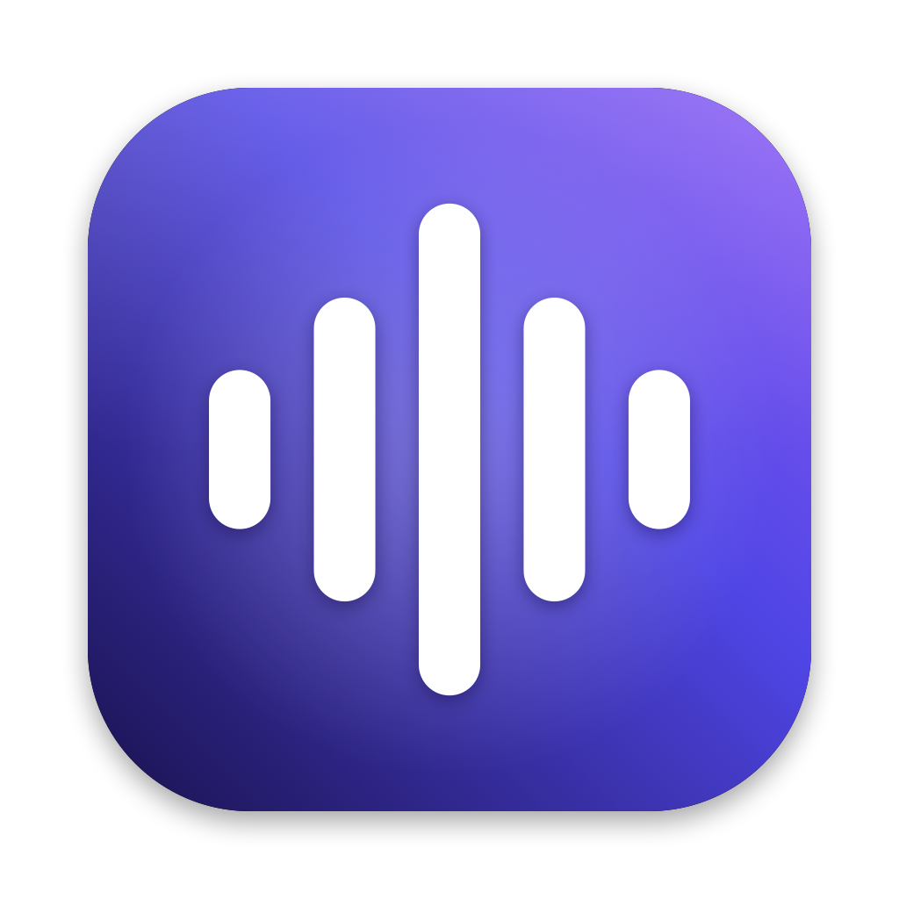
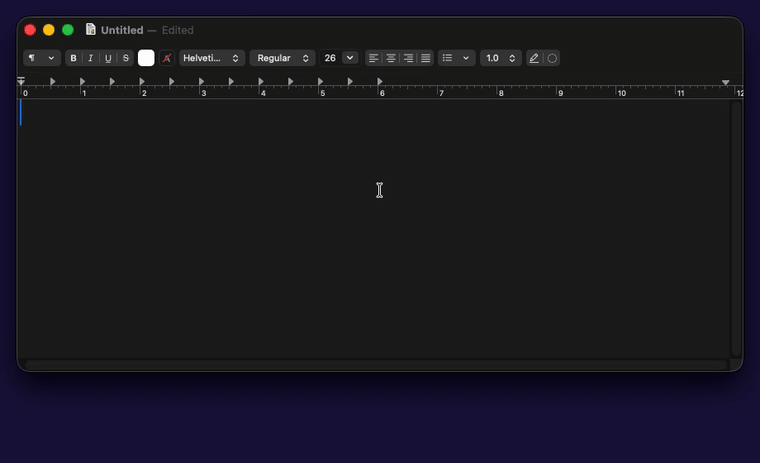
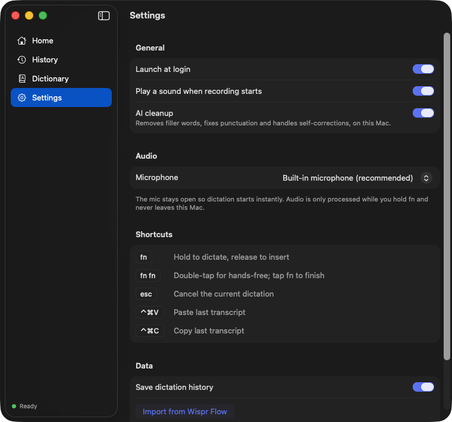

<p align="center">
  
</p>

<h1 align="center">Local Dictation</h1>

<p align="center">
  Hold <kbd>fn</kbd>, talk, release. Clean text appears wherever your cursor is.<br>
  On-device speech recognition and AI cleanup for macOS. Nothing leaves your Mac.
</p>

---

I built this to replace a $15/month cloud dictation app whose accuracy I liked but whose
1–2 second delay between pressing the key and actually listening kept breaking my flow.
Local Dictation starts recording in ~50 ms, transcribes on the Apple Neural Engine, and
pastes cleaned-up text about a quarter of a second after you let go.

## Highlights

- **Instant start.** The mic stays open in a ring buffer with 0.3 s of pre-roll, so recording
  begins the moment you press fn, and even catches the syllable you started a beat early.
- **Fast, accurate transcription.** Parakeet TDT 0.6B on the Neural Engine via
  [FluidAudio](https://github.com/FluidInference/FluidAudio): a 12-second clip transcribes in
  ~90 ms, with 3.2 % word error against a commercial cloud service on the same audio.
- **AI cleanup, on device.** A 1.2B model fine-tuned on my own dictation history removes
  filler words, fixes punctuation and honors self-corrections ("at 3, no wait, 4" → "at 4"),
  running on the GPU through llama.cpp.
- **Transcribes while you talk.** Audio is segmented at natural pauses and processed in the
  background, so a two-minute dictation lands as fast as a two-second one.
- **Context-aware.** Continues mid-sentence in lowercase, fixes spacing around the cursor,
  and corrects names it can see on screen.
- **Learns from your fixes.** Correct a misheard word right after dictating ("Kubernetis" →
  "Kubernetes") and the fix is added to your dictionary, so it's right next time.
- **Native and small.** One Swift process with no Electron and no server, ~45 MB plus models.

## Demo

<p align="center">
  
</p>

<p align="center"><sub>
  Spoken: <i>"So I think we should, um, ship the new onboarding flow on Friday. No wait, Thursday.
  And let's make sure the release notes are ready before then."</i><br>
  The filler word and the self-correction are cleaned up on device.
</sub></p>

While you dictate, a small pill at the bottom of the screen shows a live waveform; it
switches to a spinner on release and the text lands at the cursor. The app also has a
window for history, a personal dictionary and settings:

<p align="center">
  
</p>

| Shortcut | Action |
|---|---|
| Hold <kbd>fn</kbd> | Push-to-talk |
| <kbd>fn</kbd> <kbd>fn</kbd> | Hands-free; tap fn to finish |
| <kbd>esc</kbd> | Cancel |
| <kbd>⌃</kbd><kbd>⌘</kbd><kbd>V</kbd> | Paste last transcript |
| <kbd>⌃</kbd><kbd>⌘</kbd><kbd>C</kbd> | Copy last transcript |

## How it works

```
fn ─► event tap ─► mark ring buffer ─► segments cut at pauses ─► Parakeet (Neural Engine)
                                                                      │
              paste at cursor ◄─ spacing / names / dictionary ◄─ cleanup LLM (llama.cpp)
```

The full write-up, with the latency breakdown, benchmarks and design decisions, is in
[`docs/DESIGN.md`](docs/DESIGN.md).

| | Result (M5 MacBook Air) |
|---|---|
| Key-down → recording | ~50 ms |
| Speech recognition, clips ≤ 20 s | 0.09 s median |
| Release → paste | ~250 ms |
| Cleanup model vs. a prompted 4B model | 30 % fewer errors, under half the latency |

## Build and run

Requirements: macOS 15+, Apple Silicon, and the Xcode Command Line Tools
(`xcode-select --install`). Full Xcode isn't needed.

```sh
git clone https://github.com/ikamal97/local-dictation.git
cd local-dictation
./scripts/create-signing-identity.sh   # optional: keeps permissions across rebuilds
./scripts/build-app.sh --install       # builds, installs to /Applications, launches
```

On first launch, macOS asks for three permissions:
- **Microphone**, to hear you.
- **Input Monitoring**, to see the fn key.
- **Accessibility**, to read the text field and paste into it.

The speech model (~500 MB) downloads automatically on first launch.

### Cleanup model

The cleanup model is trained on personal dictation history, so it isn't distributed.
Without it, the app uses rule-based cleanup (filler words, dictionary, spacing). To train
your own from your dictation history, see [`training/`](training/README.md).

### Tests

```sh
./scripts/test.sh
```

### Recording a demo

Launching with `LOCALDICTATION_DEMO_AUDIO=/path/to/speech.wav` feeds that file to the
pipeline instead of the microphone, so screencasts are reproducible:

```sh
open --env LOCALDICTATION_DEMO_AUDIO=$PWD/speech.wav /Applications/LocalDictation.app
```

## Privacy

Audio is processed only while you hold fn and never leaves the Mac. History, dictionary
and models live in `~/Library/Application Support/LocalDictation`. History can be turned
off or cleared in Settings.

## Credits

- [FluidAudio](https://github.com/FluidInference/FluidAudio) (Apache 2.0) runs
  [Parakeet TDT 0.6B v3](https://huggingface.co/nvidia/parakeet-tdt-0.6b-v3) (CC BY 4.0) on CoreML.
- [llama.cpp](https://github.com/ggml-org/llama.cpp) (MIT) runs the cleanup model.
- [LFM2.5 1.2B Instruct](https://huggingface.co/LiquidAI/LFM2.5-1.2B-Instruct) by Liquid AI is the
  base of the cleanup model ([LFM Open License v1.0](https://huggingface.co/LiquidAI/LFM2.5-1.2B-Instruct/blob/main/LICENSE)).
- [mlx-lm](https://github.com/ml-explore/mlx-lm) (MIT) is used for fine-tuning.

## License

MIT. See [LICENSE](LICENSE).
